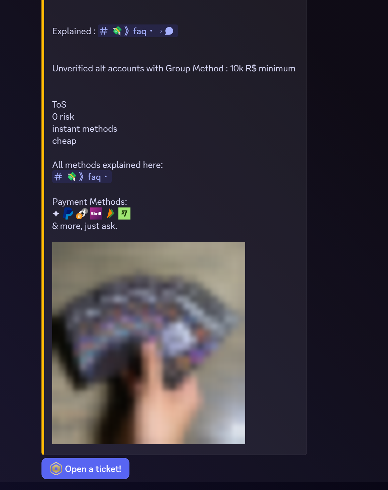
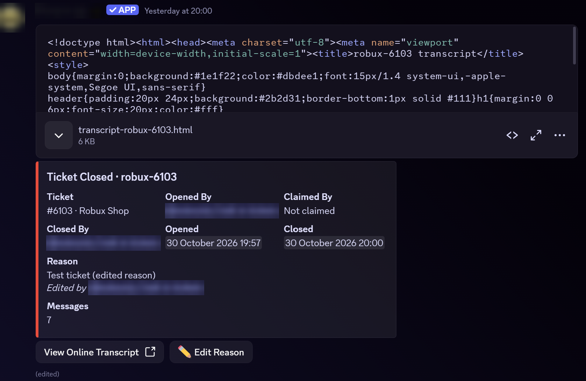

# DealDesk

A Discord bot for running a Roblox (Robux) shop server. It handles the whole buyer flow: a ticket opens from a panel, staff claim and work it, the sale is logged, and the buyer's tier roles update by themselves.

This repo is a showcase cut of a production bot that runs a live trading community with 600+ buyers. Server IDs, secrets and the anti-alt verification system have been removed. Everything else is the real code.

## In action

Screenshots from the bot running in a live server. Usernames and the bot's identity are blurred.

<p>
  
  
</p>

*Left: a ticket panel. Right: the close log, with the HTML transcript attached, the ticket details, an edited close reason, and buttons for the online transcript and editing the reason.*

## Features

**Ticket system** (`src/Tickets.js`, `src/TicketPanels.js`)
- Panels with a button that opens a **form** (modal). Answers are posted in the new private ticket channel.
- Per-panel access and support roles, a per-member open-ticket limit, and a blacklist.
- **Overflow categories.** When a category reaches Discord's 50-channel cap, new tickets go to an overflow category automatically.
- Claim, unclaim, transfer, add/remove user, rename, and private **staff notes** threads.
- Close with confirmation or with a reason, staff **close requests** that expire on their own, and an **Edit Reason** button on the log.
- **HTML transcripts**: posted to a log channel, DMed to the opener, and viewable online.
- **Star ratings** in the opener's DMs after a ticket closes, shown on the transcript log and in dealer stats.

**Web dashboard** (`src/TicketWeb.js`)
- "Sign in with Discord" (OAuth2, `identify` scope) with HMAC-signed session cookies and CSRF tokens.
- Transcripts only open for the ticket's opener and staff.
- A staff dashboard to search tickets by number, username or ID, open transcripts, and switch panels on or off (managers only).
- Only reachable through a reverse proxy that adds a shared secret header (`src/WebGateway.js`). Direct hits get a 404.

**Dealer routing** (`src/DealerTicketQueue.js`, `/ticketrouting`)
- Claimed tickets move into the claiming dealer's own category, with a per-dealer cap (default 10).
- Also works with tickets opened by the third-party *Tickets v2* bot, by reading its claim messages. This was used to migrate from it with no downtime.

**Roblox recipient confirmation** (`src/TicketRoblox.js`, `src/PayoutRecipients.js`)
- The buyer's "who receives the Robux" form answer is resolved against the Roblox API (usernames, IDs or profile links, up to 10).
- The buyer confirms the accounts with buttons in the ticket, and staff see whether they match the buyer's OAuth-linked account.

**Purchase logging** (`/logpurchase`, `/unlogpurchase`, `/dealersummary`)
- Logs a sale to MongoDB, posts a receipt embed, and DMs the buyer.
- **Buyer tier roles** are recalculated from lifetime totals right away, with a background repair job (`src/PurchaseRoles.js`).
- `/unlogpurchase` reverses a log made by mistake. It keeps an audit copy, marks the original log entry as removed, and re-syncs roles. Junior staff can only undo their own logs from the last 24 hours.
- Dealer summaries show sales, commission, ticket-handling stats and buyer ratings.

**Text commands for everything** (`src/PrefixCommands.js`)
- Every slash command also works as `.command`, built by emulating a Discord interaction, so command code is written once.
- Typed values are bound to options by name or position, with a per-command `prefixOrder`.
- Private (ephemeral) replies use a **"Show reply" button** that only the caller can press. It opens a real ephemeral message, so private output never lands in the channel.
- A typo-tolerant **help card**: unknown commands get "did you mean" suggestions (edit distance, counting adjacent swaps as one typo), and bad arguments get usage examples.

## Stack

Node.js 20+, discord.js v14, MongoDB with Mongoose, and Express for the web routes.

## Layout

```
src/
  index.js               client setup, command loader, interaction routing, web server
  deploy-commands.js     registers slash commands for the configured server
  config.js              loads config.json (falls back to config.example.json)
  Tickets.js             ticket lifecycle, transcripts, ratings, blacklist, overflow
  TicketPanels.js        panel definitions: forms, roles, naming, welcome text
  TicketWeb.js           OAuth sign-in, transcript viewer, staff dashboard
  TicketRoblox.js        Roblox recipient confirmation inside tickets
  DealerTicketQueue.js   claim routing into dealer categories + claim history
  PrefixCommands.js      dot-command emulation of slash commands
  PurchaseRoles.js       buyer tier roles from lifetime purchase totals
  commands/tickets/      /claim /close /transfer /add /remove /rename /notes ...
  commands/staff/        /logpurchase /unlogpurchase /dealersummary /ticketrouting
scripts/check.js         syntax + require-resolution check (no install needed)
```

## Running it

```bash
npm install
cp .env.example .env              # bot token, client ID, MongoDB URL
cp config.example.json config.json  # your guild, channel and role IDs
npm run deploy                    # register slash commands
npm start
```

The bot needs the **Server Members** and **Message Content** privileged intents. Online transcripts and the dashboard are optional: set `PUBLIC_URL`, `GATEWAY_KEY` and `DISCORD_OAUTH_CLIENT_SECRET`, and add `<PUBLIC_URL>/tickets/auth/callback` as a redirect in the Discord developer portal.

## Licence

MIT
